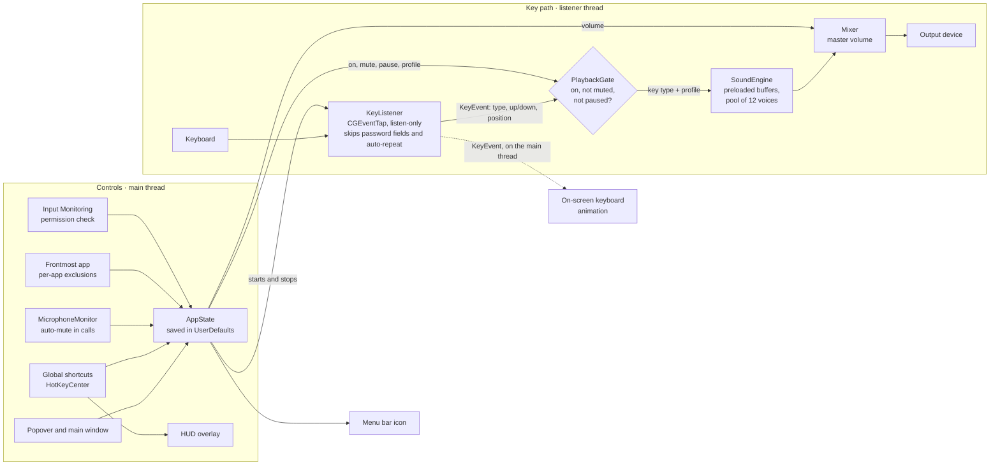

# Clackwork

[](https://github.com/khamkarsuraj/clackwork/releases)
[](https://github.com/khamkarsuraj/clackwork/releases)
[](https://github.com/khamkarsuraj/clackwork/actions/workflows/ci.yml)


A native macOS menu bar utility that plays mechanical keyboard sounds as you type in any app.

## Status

Early v1.0 development.

| Area                                                                      | State                                      |
| ------------------------------------------------------------------------- | ------------------------------------------ |
| Main window: profiles, preview, volume, Try it field, light and dark mode | Done                                       |
| Sound engine with 4 profiles: Cobalt Clack, Walnut Bump, Onyx Thock and Ember Tap | Done, using development recordings; in-house recordings pending (#49) |
| System-wide key listener                                                  | Done                                       |
| Global shortcuts, customizable in Settings                                | Done                                       |
| Settings: launch at login, Dock icon, Input Monitoring status             | Done                                       |
| Menu bar popover and icon states                                          | Not started                                |
| Onboarding, HUD overlay                                                   | Not started                                |
| In-house or confirmed-license recordings                                  | Not started                                |
| Auto-mute while the microphone is in use                                  | Done                                       |
| Per-app exclusions                                                        | Done                                       |

## Build and run

- Xcode 26 or later. Deployment target is macOS 13 Ventura.
- Open `clackwork.xcodeproj`, select the `clackwork` scheme, and press Cmd+R.
- Two app targets build the same sources: `clackwork` is the direct download (a notarized DMG, which gets Sparkle updates in #77), and `clackwork App Store` is the Mac App Store build, compiled with `APP_STORE` and never linked against Sparkle. Both are sandboxed. Code that differs between them checks `Distribution.isAppStore`. Their build settings live in `Config/`; change them there, not in Xcode's Build Settings pane, so the two can't drift apart.

## Tests

Press Cmd+U in Xcode, or run:

```
xcodebuild test -project clackwork.xcodeproj -scheme clackwork -destination 'platform=macOS'
```

Unit tests live in `clackworkTests/` and use Swift Testing. Each suite names the PRD requirement or issue it covers. They need no sound packs, audio device or Input Monitoring permission. The keyboard animation test briefly opens a small borderless window.

CI runs the same tests on every pull request and on every push to `main` (`.github/workflows/ci.yml`). Mark `build-and-test` and `test-intel` as required checks in the branch settings so a pull request can't merge until they pass. CPU, memory and latency targets are measured locally, since they need the sound packs and real audio hardware; see the sections below.

To run the tests as Intel code on an Apple silicon Mac (under Rosetta), use `-destination 'platform=macOS,arch=x86_64'`.

## Compatibility

Clackwork runs on macOS 13 Ventura and later, on Apple silicon and Intel (PRD NFR, issue #39).

- **Checked on every pull request:** the Release build is universal (`arm64` and `x86_64`) and targets macOS 13, and the tests pass on Apple silicon and on an Intel runner.
- **Checked by the compiler:** an API newer than macOS 13 doesn't build without an `#available` check. Today there's one, for a macOS 26 toolbar style.
- **Checked at runtime:** auto-mute needs the per-process audio API of macOS 14.2. On older versions the setting is disabled and says "Needs macOS 14.2 or later".
- **Checked by hand:** that the app launches and works on macOS 13 itself. GitHub has no macOS 13 runners, so use a macOS 13 Mac or virtual machine.

## Permissions

Hearing keys in other apps requires **Input Monitoring**. Click "Allow Input Monitoring…" in the app, then enable Clackwork in System Settings. Listening starts on its own within a few seconds, with no relaunch.

Without the permission, sound still plays from the Preview button and the Try it field.

Debug builds from Xcode can lose the grant after a rebuild. If keys go silent, toggle Clackwork off and on in Input Monitoring.

## Privacy

The key listener is listen-only. It passes on only the key category, such as standard, space or modifier, and the key's position on the drawn keyboard for animation. Characters are never read, stored or sent anywhere. Password fields are skipped.

## Default shortcuts

| Action                    | Shortcut  |
| ------------------------- | --------- |
| Sound on or off           | ⌃⌥O       |
| Mute or unmute            | ⌃⌥M       |
| Next or previous keyboard | ⌃⌥→ / ⌃⌥← |
| Volume up or down         | ⌃⌥↑ / ⌃⌥↓ |
| Show keyboard shortcuts   | ⌃⌥S       |

## Measuring latency

Key press to sound latency must stay under 20 ms (PRD NFR, issue #32). It has four parts:

| Part | What it covers | How it's measured |
| --- | --- | --- |
| Delivery | Hardware key event to the event tap | Live, with the latency probe |
| Hand-off | Event tap to the sound being scheduled | Live, with the latency probe |
| Render wait | Scheduled to the next audio cycle, at most one IO buffer | From the device's buffer size |
| Output | Audio cycle to the speaker | From the device's reported latency |

**Repeatable bench.** Use this to check a build and compare it with an earlier one. It needs no typing or permissions, only the sound packs in `clackwork/Sounds`, and it plays silently.

1. Switch the Mac's sound output to the built-in speakers or wired headphones.
2. From the project folder, run `scripts/latency_bench.sh`. It builds Release, then sends 1,000 simulated key presses 30 ms apart through the same path a real key takes after the event tap (the playback gate, then the sound engine on a user-interactive thread). It takes about a minute.
3. Read the summary:

   ```
   output: MacBook Pro Speakers, audio path 6.8 ms (512 frames at 96000 Hz)
   handoff   p50  0.06  p95  0.11  max  0.18 ms
   total     p50  6.85  p95  6.90  max  6.97 ms
   Saved perf-results/latency-2b4a925-20261024-223006.json
   ```

   - **output** is the device measured and its audio path: one full IO buffer of render wait plus the device's output latency.
   - **handoff** is Clackwork's own work per key. It should stay well under 1 ms.
   - **total** is hand-off plus the audio path, roughly what you hear. **p95 must stay under 20 ms**; the target is 10 ms.
   - p50 is the typical key, p95 the slowest 1 in 20, max the single slowest.
   - A `FAIL:` line means total p95 is over 20 ms. If you also see `warning: … looks like Bluetooth`, the output device is the cause; switch outputs and run again.
4. Keep the saved file as a baseline. After a change, run again with `--compare`:

   ```
   scripts/latency_bench.sh --compare perf-results/latency-2b4a925-20261024-223006.json
   ```

   It prints old and new side by side and ends with `PASS`, or `FAIL` and exits 1 if total p95 is over 20 ms or more than 1 ms worse than the baseline. `warning: different setup` means the runs used a different device, buffer size, Mac or profile, so the numbers aren't like for like.

Reports go to `perf-results/`, which isn't committed since numbers depend on the Mac. Each report records the commit (with `-dirty` when tracked files had uncommitted changes), date, Mac, macOS, output device and buffer size. `--keys 300` makes a shorter run, `--profile cobalt-clack` measures another profile, and `--interval 50` types more slowly. Delivery from the hardware to the tap belongs to macOS and isn't included; the live measurement below covers it.

**Live measurement.** In Xcode, open Product > Scheme > Edit Scheme > Run > Arguments and add `-measureLatency YES`. Run the app, grant Input Monitoring, and type at least 100 keys in any app. Every 100 key presses the Xcode console prints p50, p95 and max for each part and for the total, followed by the same numbers as a `latency-report:` JSON line. Save that JSON to a file to compare it with `scripts/latency_report.py compare old.json new.json`. The probe records timestamps only, never which key was pressed.

**Audio path only.** No key presses needed:

```
clackwork.app/Contents/MacOS/clackwork --latency-report 1
clackwork.app/Contents/MacOS/clackwork --test-soundpacks 1
```

To compare IO buffer sizes, add `-ioBufferFrames 128` or any other size.

Bluetooth headphones add 100 ms or more of their own latency, which the app can't reduce. Measure with built-in speakers or wired output.

## Measuring CPU

CPU must stay under 1% on average while idle and under 5% during sustained fast typing (PRD NFR, issue #33). Measure a Release build; Debug builds are unoptimized and not representative.

Add the launch argument `-measureCPU YES`, either in Xcode (Product > Scheme > Edit Scheme > Run, with Build Configuration set to Release) or from Terminal:

```
open clackwork.app --args -measureCPU YES
```

Every 15 seconds the probe logs the app's average CPU, as a percentage of one core (the same scale as Activity Monitor). It splits the time into three parts. Typing is seconds with at least one key press, and the log also shows the typing rate. Settling is the first 5 seconds after the last key, while sounds and animations finish. Idle is everything after that. It skips the first 10 seconds after launch, and it counts key presses only, never which key was pressed. To watch the log outside Xcode:

```
log stream --predicate 'subsystem == "com.surajkhamkar.clackwork" && category == "cpu"'
```

For the typing number, type fast and steadily for at least 15 seconds in another app. Check idle both with the main window open and with it closed.

## Measuring startup

The first key press must play within 1 second of launch, with every profile loaded (PRD NFR, issue #36). Measure a Release build; a Debug build loads the packs unoptimized and takes several times longer.

Add the launch argument `-measureStartup YES`, or run the binary from Terminal:

```
clackwork.app/Contents/MacOS/clackwork -measureStartup YES
```

Each milestone prints the time since the kernel started the process, so dyld and framework loading count too: `sounds ready` (every pack decoded and pitch-rendered, engine running), `listener on` (the key tap is up, or why it isn't) and `menu bar icon up` (drawn on the first pass of the run loop). On an Apple silicon MacBook a Release build reports sounds ready at about 300 ms and the listener on about 50 ms later, so the first key can play with every pack loaded well inside the budget. The milestones also go to the unified log:

```
log stream --predicate 'subsystem == "com.surajkhamkar.clackwork" && category == "startup"'
```

## Measuring memory

Memory must stay under 80 MB with every profile loaded (PRD NFR, issue #34). Measure a Release build with the main window open, after it has settled for a few seconds:

```
footprint -p $(pgrep -nx clackwork)
```

`Footprint` is the number that counts, the same one Activity Monitor shows as Memory. With the development packs an Apple silicon MacBook reads about 62 MB. The sounds themselves take about 13 MB (the `caulk::audio_buffer_resource` zone in `vmmap --summary`); packs are read slice by slice, so a longer recording doesn't cost memory, only more or longer slices do.

## Architecture

A listen-only key tap feeds a preloaded audio engine. The key path runs on the listener's own thread, so a busy UI can never delay a sound. Everything the user controls lives in `AppState` on the main thread, which reaches the key path only through the playback gate, the mixer volume and starting or stopping the listener.



Only the key type picks the sound. The key's position travels with it for the on-screen keyboard animation, in memory only. Characters are never read.

## Project layout

```
clackwork/
├── App/          App entry, object container, debug tooling
├── Diagnostics/  Latency, CPU and startup probes, and the latency bench
├── Audio/        Sound engine and recorded pack loader
├── Listener/     System-wide key event tap
├── Models/       Profiles, key types, keyboard layout, shortcuts
├── Shortcuts/    Global hot key registration
├── Sounds/       Recorded sound packs bundled with the app, and their license notices
├── State/        App state and shortcut store
└── Views/        Main window, Keyboards, Settings, Shortcuts
clackworkTests/   Unit tests
Config/           Build settings shared by both app targets, plus the App Store additions
```

## Sound packs

Recorded packs live in `clackwork/Sounds/` as `<profile-id>.caf` and `<profile-id>.json`, one per profile: `cobalt-clack`, `walnut-bump`, `onyx-thock` and `ember-tap`. A profile without a pack is silent.

The packs are committed, so a fresh clone plays every profile; their source originals stay out of the repo. A pack is a folder with one audio file and a `config.json` that maps key scan codes to `[start ms, duration ms]` slices of it. To add or replace one, run:

```
scripts/import_soundpack.sh <pack-folder> <profile-id>
```

Keep each pack's license notice in `clackwork/Sounds/ThirdPartyNotices.txt` so it ships with the sounds.

## Releasing

The direct-download build ships as a notarized DMG attached to a GitHub release, and Sparkle (#77) reads an appcast served by GitHub Pages. Pushing a version tag does all of it:

```
git tag v1.0.0
git push origin v1.0.0
```

`.github/workflows/release.yml` then archives the `clackwork` scheme as a universal Release build, with the version from the tag and the commit count as the build number, signs it with Developer ID, runs `scripts/package_dmg.sh` to make, notarize and staple `Clackwork-<version>.dmg`, creates the release with generated notes, and commits to the `gh-pages` branch: `latest.json` and the landing page's download link now point at the new DMG, and `appcast.xml` gains the release. A pre-release doesn't replace a stable release on the landing page. A tag with a suffix, such as `v1.1.0-beta.1`, becomes a pre-release. The dSYMs are kept as a workflow artifact for 90 days.

The workflow needs these repository secrets (Settings > Secrets and variables > Actions):

| Secret | What it is |
|---|---|
| `DEVELOPER_ID_P12_BASE64` | The Developer ID Application certificate with its private key, exported from Keychain Access as a `.p12` and encoded with `base64 -i cert.p12` |
| `DEVELOPER_ID_P12_PASSWORD` | The password chosen on export |
| `NOTARY_KEY_ID`, `NOTARY_ISSUER_ID`, `NOTARY_KEY_BASE64` | An App Store Connect API key with the Developer role: its key ID, the issuer ID, and the `.p8` file encoded with `base64 -i AuthKey.p8` |
| `SPARKLE_PRIVATE_KEY` | The EdDSA private key printed by Sparkle's `generate_keys -x`. Without it the release is still published; only the appcast step is skipped |

GitHub Pages serves the `gh-pages` branch, which also holds the landing page at https://khamkarsuraj.github.io/clackwork/. The page reads `latest.json` for its download button and falls back to the GitHub API, preferring a stable release over a pre-release; its static link always points at a DMG too, so it works without JavaScript. The appcast is at `https://khamkarsuraj.github.io/clackwork/appcast.xml`, which is the feed URL for #77. Sparkle fetches both the appcast and the DMG without signing in, so the repository has to stay public for updates to reach anyone.

To package by hand, build a Developer ID signed app (Product > Archive in Xcode, then Distribute App > Direct Distribution > Export), store notarization credentials once with `xcrun notarytool store-credentials clackwork`, and run:

```
scripts/package_dmg.sh --app path/to/clackwork.app --notary-profile clackwork
```

Without a `--notary-profile` or `--notary-key` the script only signs the DMG, which is enough to check the image locally.

## Debug tools

Debug builds accept launch flags that need no screen recording permission. Run the binary inside the built app:

```
clackwork.app/Contents/MacOS/clackwork --snapshot <out.png> [--dark] [--section settings]
clackwork.app/Contents/MacOS/clackwork --export-sounds <dir>
clackwork.app/Contents/MacOS/clackwork --stress-sounds 300
clackwork.app/Contents/MacOS/clackwork --test-shortcuts 1
clackwork.app/Contents/MacOS/clackwork --test-keymap 1
clackwork.app/Contents/MacOS/clackwork --latency-report 1
```
